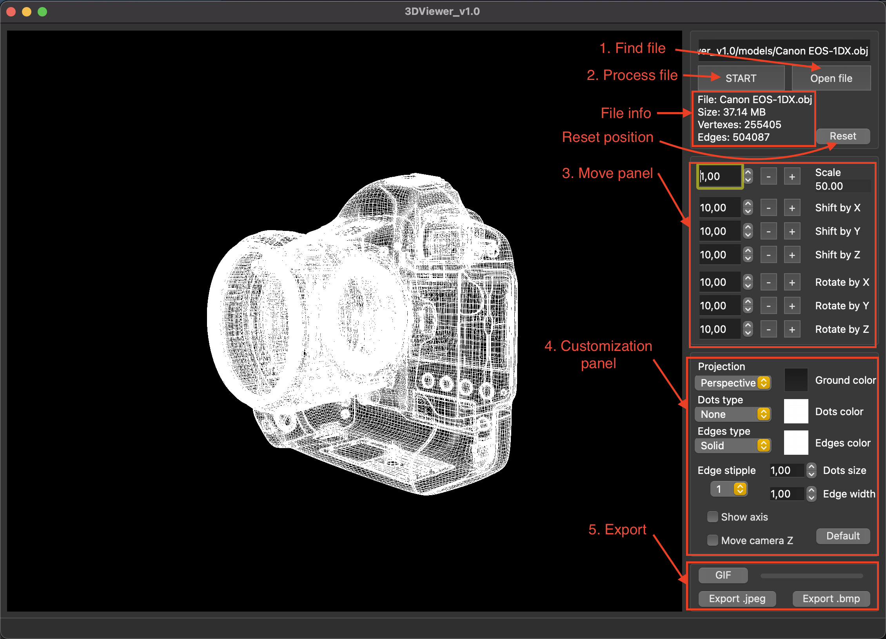

# 3DViewer v1.0

## Introduction

The program is an implementation of Wavefront .obj 3d model viewer, created for educational purpose. The application allows user to view skeleton of a model and only shows vertices and edges. It has set of different customization options. \
Modules, file parser and affine transitions specifically, were written on C language, whilst UI elements were constructed using C++ QT framework and used 3D rendering with OpenGL.

## Content

1. [Install](#install)
2. [Uninstall](#uninstall)
3. [Misc](#misc)
4. [Description](#description)
5. [Authors](#authors)

## Install

Make sure you have gcc, make, qmake and QT of version 4 or more installed. \
All `make` command are supposed to be performed in `src` directory.

To install application use `make install` command. \
The application will be located in `3DViewer_v1.0/3DViewer_v1.0` of the project. \
Use `make run` to run. \
There will be pack of object models in `3DViewer_v1.0/models/` after installation.

## Uninstall

To uninstall application use `make uninstall` command.

## Misc

- `make clean` - clear all files created during installation or else.
- `make dist` - create distribution archive `.tar` with all content.
- `make distclean` - delete created distribution archive.
- `make dvi` - open README.md.
- `make test` - perform tests for modules. It uses `checkmk` utility.
- `make gcov_report` - perform tests and create code analysis report. It uses `lcov` utility.
- `make style` - check for codestyle.
- `make memtest` - use memcheck utility to analyze for leaks with tests. Uses `valgrind` or `leaks` depending on OS.
- `make memtest_app` - use memcheck utility to analyze for leaks with running app.

## Description

1. Find `.obj` file to view. Path will be shown in the text field.
2. Press `START` to perform file into view mode. `Reset` button resets position and scale to the default.
3. The panel holds three dimensional - translation by one axis, rotation around axis and scaling. Scaling has limits of motion. \
  View area has limits on Z axis aswell.
4. Customization options:

- Colors of dots, lines and background.
- Size of dots, width of lines.
- Perspective or parallel projection.
- Circle, square or none appearance of dots.
- Show axis.
- Solid or dotted line type. There are 8 patterns of dotted line.
- Move camera on Z axis. NOTE: if active, allows camera to follow model motion on Z axis, \
  thus there is no possibility for model to be out of our sight.

  Settings will be saved on exit. To drop settings to the default press `Default` button.

5. The application supports exporting images in JPEG, BMP formats. \
  Also it allows to cut short animation scenes in GIF format (5 seconds, 10 fps, 640x480).

## Authors

chiqtuita \
vindicao
